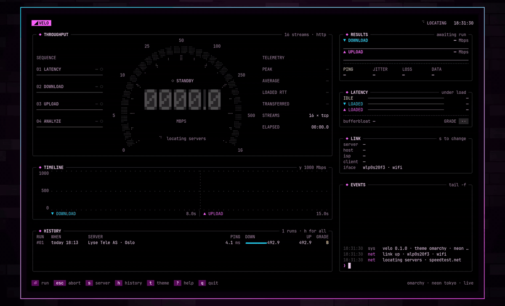
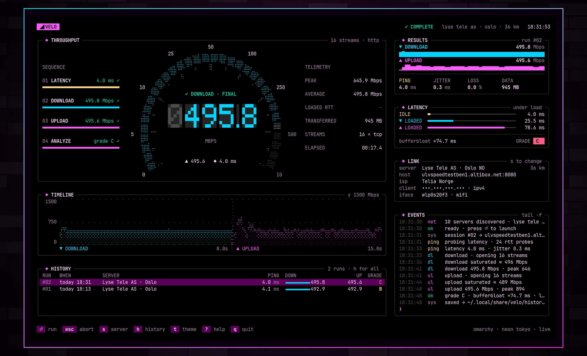
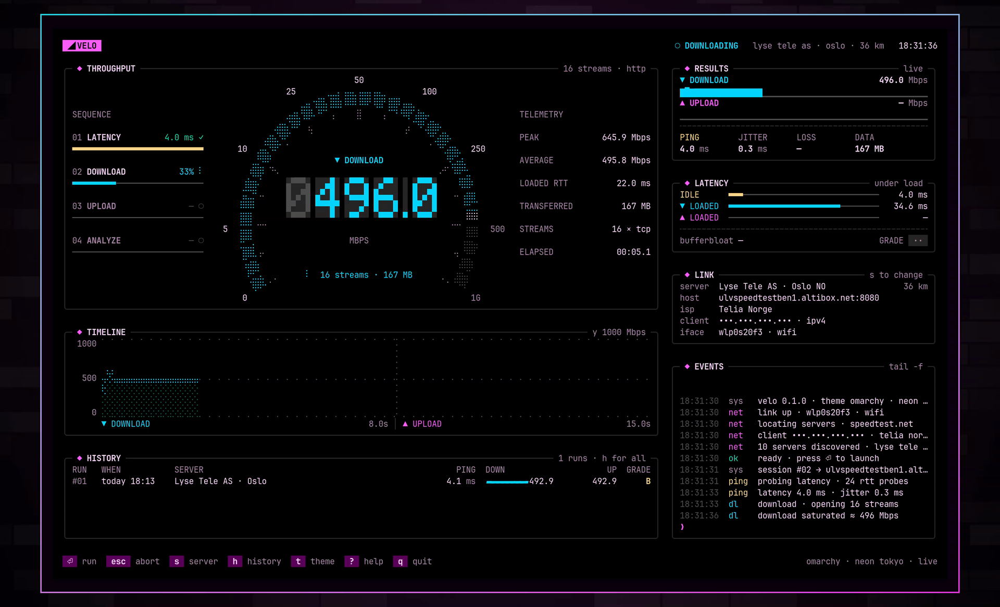
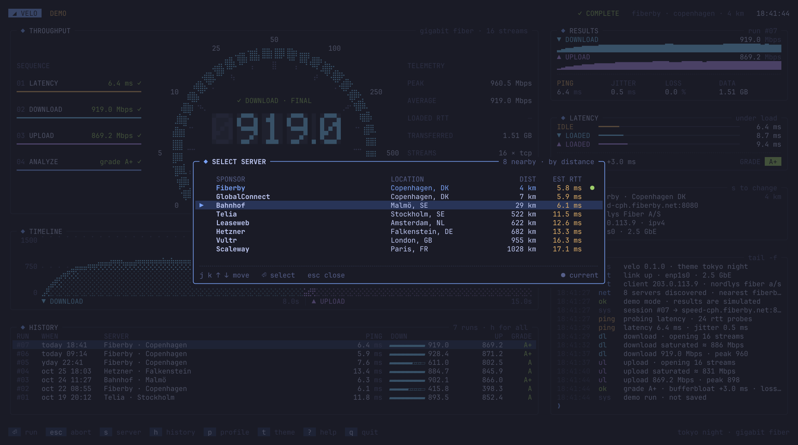
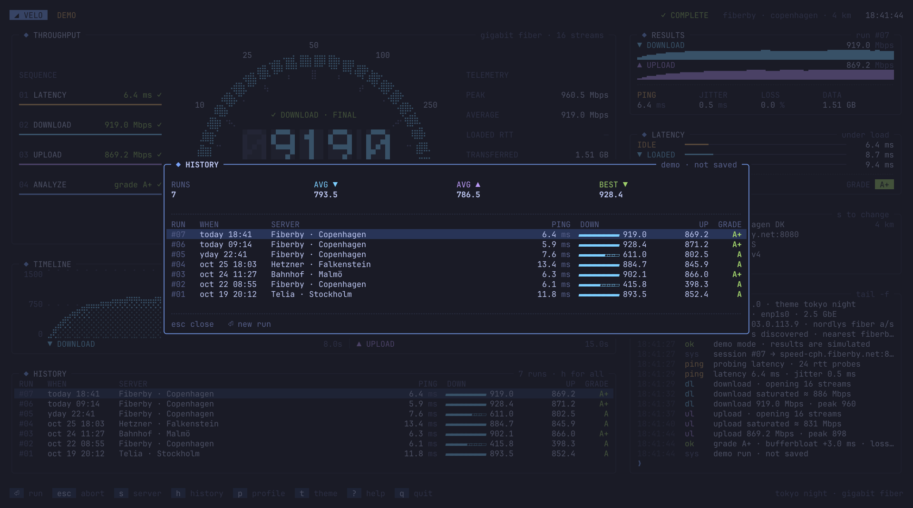
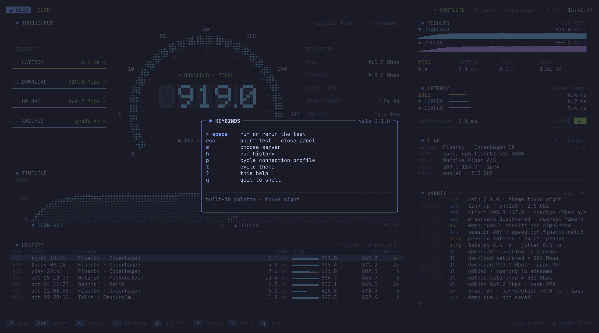
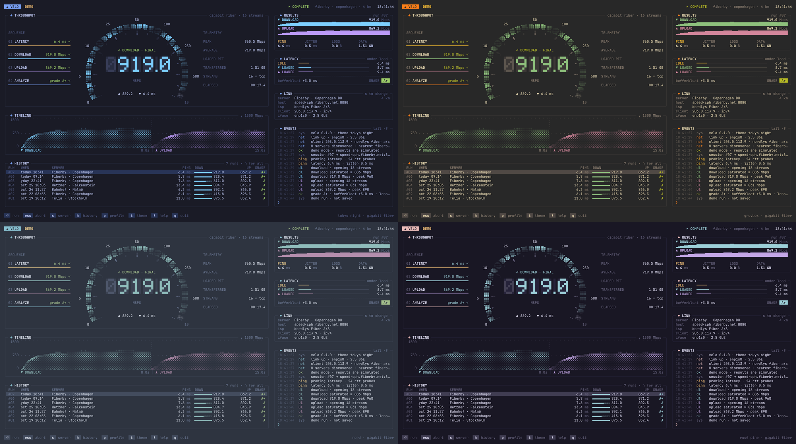
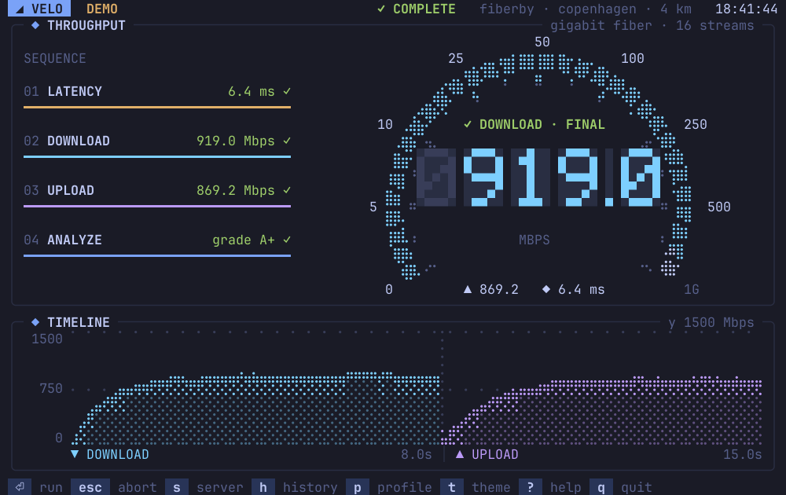

<p align="center">
  
</p>

<p align="center">
  velo is a speed test for the terminal.<br>
  It measures latency, download, upload, and bufferbloat, and shows each phase live on a cockpit dashboard.
</p>

<p align="center">
  
</p>

<p align="center">
  <a href="https://github.com/bjarneo/velo/releases/latest">Download</a> ·
  <a href="assets/velo.mp4">Watch the video</a> ·
  <a href="docs/measurement.md">How velo measures</a> ·
  <a href="docs/architecture.md">Architecture</a> ·
  <a href="AGENTS.md">Agent guide</a>
</p>

## Install

### Omarchy and other Linux

Run the install script:

```sh
curl -fsSL https://raw.githubusercontent.com/bjarneo/velo/main/install.sh | sh
```

The script downloads the latest release for your CPU, verifies the SHA-256 checksum, and installs `velo` to `~/.local/bin`. Release builds are for `amd64` and `arm64`.

To add velo to the Omarchy app launcher, run:

```sh
omarchy-tui-install velo velo tile https://raw.githubusercontent.com/bjarneo/velo/main/assets/icon.png
```

Then press `Super` + `Space` and type `velo`.

### With Go

velo needs Go 1.25 or later.

```sh
go install github.com/bjarneo/velo@latest
```

### From source

```sh
git clone https://github.com/bjarneo/velo.git
cd velo
go build -o velo .
./velo
```

## Run a test

```sh
velo
```

velo finds the 10 nearest speedtest.net servers, measures the latency to each server, and selects the fastest one. Then it starts the test. A test takes about 18 seconds.

When you quit, velo prints the result of the last run:

```
velo: session closed · last run ↓ 495.8 ↑ 495.6 Mbps · 4.0 ms · C
```

### Flags

| Flag | Result |
| --- | --- |
| `--no-autostart` | velo waits for `⏎` before it starts a test. |
| `--server 64051` | velo uses the server with this ID. The server list shows the IDs. |
| `--theme nord` | velo starts with a built-in theme. |
| `--private` | velo masks your IP address. Use it for screenshots and recordings. |
| `--demo` | velo simulates the network. No data leaves the machine. |
| `--version` | velo prints its version. |

Theme names for `--theme`: `omarchy`, `tokyo-night`, `catppuccin`, `gruvbox`, `nord`, `everforest`, `kanagawa`, `rosé-pine`, `matte-black`.

### Keys

| Key | Action |
| --- | --- |
| `⏎` or `space` | Run or rerun the test |
| `esc` | Abort the test or close a panel |
| `s` | Choose a server. Use `j` and `k` or the arrow keys, then `⏎`. |
| `h` | Show the run history |
| `t` | Cycle the theme |
| `?` | Show the keys |
| `q` | Quit |

You can also click the keys in the footer and the rows in the server list.

## The dashboard



| Panel | Content |
| --- | --- |
| **Throughput** | The gauge, the live readout, the test sequence, and live telemetry. |
| **Timeline** | Download and upload throughput over the 15 seconds of transfer. |
| **History** | The last runs from the history file. |
| **Results** | Download and upload with sparklines, ping, jitter, loss, and data used. |
| **Latency** | Idle and loaded latency, bufferbloat, and the grade. |
| **Link** | The server, the server host, your ISP, your IP address, and your network interface. |
| **Events** | A log of each step of the test. |

The screenshots above and below use the Omarchy theme Neon Tokyo. The IP address is masked with `--private`.



### Server list, history, and keys

The screenshots in this section use `--demo` and the Tokyo Night theme.







### Themes

On Omarchy, velo uses the colors of the active theme. When you change the Omarchy theme, velo changes its colors in 2 seconds or less. velo also has 8 built-in themes. Press `t` to cycle them.



### Small terminals

The full dashboard needs about 180×46 cells. In a narrower terminal, velo hides the telemetry column, then the right column. In a shorter terminal, velo hides the history panel and makes the gauge smaller. The minimum size is 64×22.



## How velo measures

A test has 3 phases.

1. **Latency.** velo sends 24 HTTP requests for `latency.txt` on one warm connection. Ping is the mean round-trip time. Jitter is the mean difference between two probes in sequence.
2. **Download.** velo opens 16 HTTP streams for 8 seconds and counts the bytes that it reads.
3. **Upload.** velo opens 16 HTTP streams for 7 seconds. On Linux, it counts the bytes that the server acknowledged. On other systems, it counts the bytes that it writes.

During download and upload, velo sends a latency probe every 250 ms. Bufferbloat is the higher loaded latency minus the idle latency.

| Bufferbloat | Grade |
| --- | --- |
| less than 5 ms | A+ |
| less than 30 ms | A |
| less than 60 ms | B |
| less than 200 ms | C |
| 200 ms or more | D |

A test moves about 1 GB of data on a 500 Mbps link. For the sampling method, the endpoints, and the limits of each value, read [docs/measurement.md](docs/measurement.md).

## Read the results from a script

velo appends each finished run to `$XDG_DATA_HOME/velo/history.jsonl`. The default path is `~/.local/share/velo/history.jsonl`. Each line is one JSON object:

```json
{"id":2,"time":"2026-10-27T18:31:48+01:00","server":"Lyse Tele AS · Oslo","host":"ulvspeedtestben1.altibox.net:8080","ping_ms":3.96,"jitter_ms":0.32,"down_mbps":495.84,"up_mbps":495.56,"bloat_ms":74.69,"loss_pct":0,"grade":"C","data_mb":945.34}
```

To show the download speed of the last run, run:

```sh
tail -n 1 ~/.local/share/velo/history.jsonl | jq .down_mbps
```

`--demo` does not write to the file.

## Privacy

velo sends these requests:

- A request to speedtest.net for the server list.
- A request to speedtest.net for your IP address and ISP.
- The test traffic to the server that you select.

velo does not send your results to any service. The results stay in the history file.

## Development

```sh
go test -race ./...
go vet ./...
go run . --demo
```

`--demo` runs the full interface with a simulated network. The tests include a render test that draws every phase and every panel at many terminal sizes.

For the code structure, read [docs/architecture.md](docs/architecture.md). For instructions to coding agents, read [AGENTS.md](AGENTS.md).

## Limits

- LOSS counts latency probes that failed or took longer than the timeout. velo uses TCP, so this value is not the packet loss of the link.
- velo depends on the speedtest.net server list. When the list is not available, velo shows an error. Press `⏎` to try again.
- velo draws with one-column glyphs. Some fonts in East Asian locales draw these glyphs two columns wide. Then the layout breaks.
