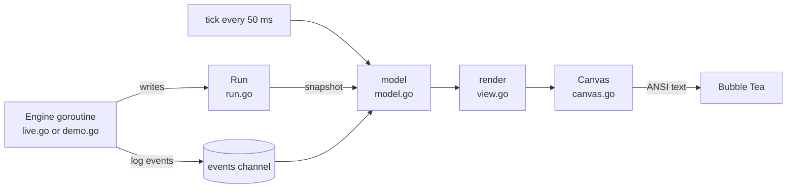

# Architecture

velo is one Go package. It uses [Bubble Tea v2](https://github.com/charmbracelet/bubbletea) for the program loop and draws every cell itself.

## Data flow



1. The engine runs in its own goroutine. It writes samples and results to a `Run`. A mutex protects the `Run`.
2. On each tick, the model copies the `Run` into a `Snapshot`. The sample slices only grow, so the copy shares their arrays without a race.
3. `render` draws the snapshot into a `Canvas`. The `Canvas` is a grid of cells with a glyph, colors, and a bold flag.
4. `Canvas.String` writes the grid as ANSI text with 24-bit colors. Bubble Tea reduces the colors when the terminal has fewer.

The model ticks every 50 ms during a test and every 110 ms when idle.

## Files

| File | Content |
| --- | --- |
| `main.go` | Flags, the theme list, and the program start. |
| `model.go` | The Bubble Tea model, keys, mouse clicks, history records, and the Omarchy theme reload. |
| `run.go` | The `Run` state, the `Snapshot`, phases, results, and the grade. |
| `live.go` | Server discovery and the speedtest.net engine. |
| `acked_linux.go` | The count of acknowledged upload bytes from `TCP_INFO`. |
| `acked_other.go` | The fallback for systems without `TCP_INFO`. |
| `demo.go` | The simulated engine, the demo servers, and the demo history. |
| `view.go` | The layout and every panel and modal. |
| `canvas.go` | The cell grid, text helpers, click regions, and ANSI output. |
| `braille.go` | The braille plots for the gauge and the timeline, and the dot-matrix digits. |
| `theme.go` | The built-in themes and the Omarchy `colors.toml` reader. |
| `history.go` | The `history.jsonl` store. |
| `netinfo.go` | The default network interface and its link speed. |

## Rendering

### Braille plots

The gauge and the timeline draw on a grid of dots. Each terminal cell holds a braille glyph of 2×4 dots. Each dot has a category, for example "grid", "fill", or "edge". `pack` turns the dots into glyphs and gives each cell the highest category of its dots. The category selects the color.

### Gauge geometry

A terminal cell is about 2.1 times higher than it is wide. The constant `cellAspect` holds this value. `newGaugeGeom` uses it to fit the largest round arc, with its labels, into the panel. The arc covers 240°. It has a segmented outer band and 17 ticks.

### Dot-matrix digits

The readout uses a 5×7 font. Each terminal cell shows 2 pixels with the glyph `▀`. The foreground color is the top pixel and the background color is the bottom pixel. Leading zeros use the ghost color. When the arc radius is less than 18 cells, velo shows the value as text.

### Layout

`drawCockpit` divides the screen. These rules apply in this order:

1. When the left column would be narrower than 88 cells, velo hides the right column.
2. When the throughput panel is too narrow for the gauge, the sequence, and the telemetry, velo hides the telemetry. Then it hides the sequence.
3. When the screen is too short, velo hides the history panel. Then it makes the gauge smaller.
4. When the area between the header and the footer is 40 rows or more, velo puts a blank row between panels.

The minimum size is 64×22. On a smaller screen, velo shows only the required size.

## Themes

A `Theme` has 11 named colors. velo calculates 2 more: `Ghost` is half way between `Dim` and `Bg`, and `Line` is 13 % of `Fg` over `Bg`.

velo reads the active Omarchy theme from `colors.toml` in these folders, in this order:

1. `$XDG_STATE_HOME/omarchy/current/theme`
2. `~/.config/omarchy/current/theme`

| velo color | Omarchy keys, first match wins |
| --- | --- |
| `Bg` | `background` |
| `Fg` | `foreground` |
| `Acc` | `accent`, `blue`, `color4` |
| `Dim` | `dark_foreground`, `color8`, `muted` |
| `Sel` | `selection`, `selection_background` |
| `Cyan` | `cyan`, `color6` |
| `Mag` | `magenta`, `color5` |
| `Yel` | `yellow`, `color3` |
| `Grn` | `green`, `color2` |
| `Red` | `red`, `color1` |

Every 2 seconds, velo compares the modification time of `colors.toml` with the last value. When the time changes, velo reads the file again.

To add a built-in theme, add a `newTheme` line to `builtinThemes` in `theme.go`.

## Tests

```sh
go test -race ./...
```

| Test | What it checks |
| --- | --- |
| `TestRenderSizes` | velo draws every phase and modal at 29×14 sizes without a panic. |
| `TestDemoRun` | The engine and the UI read and write the `Run` without a data race. |
| `TestPrivateMasksIP` | `--private` removes the IP address from the screen and the log. |
| Other tests | Theme parsing, the grade, the readout format, the gauge scale, braille packing, sparklines, the history file, and the upload counter. |
